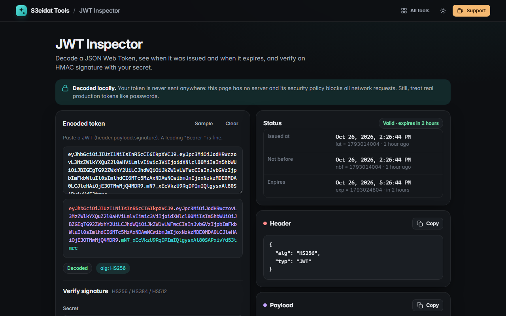

# JWT Inspector

> Decode JSON Web Tokens locally and check their expiry. Free, private, and it runs entirely in your browser.

### ▶ [Open JWT Inspector](https://s3eidat.github.io/jwt-inspector/)



## Features

- Paste a JWT (with or without `Bearer `): the **header, payload and signature** are colour-coded
- Pretty-printed **header and payload JSON**, each with a copy button
- **Human dates** for `iat`, `nbf`, `exp` and `auth_time`, with a status like *Expired 3 hours ago*,
  *Valid · expires in 2 hours* or *Not valid yet*; warns when a time looks like milliseconds
- Friendly names for registered claims (`iss`, `sub`, `aud`, `jti`, …)
- **Verify HMAC signatures** (HS256, HS384, HS512) with your secret, plain or Base64-encoded
- Flags `alg: none` (unsigned) tokens and explains encrypted JWE tokens instead of failing silently

RSA and ECDSA tokens (RS256, ES256, …) are decoded but their signatures are not verified.

## Privacy

Tokens and secrets never leave your device and the secret is never saved. There is no server,
no account, no analytics. The page ships with a strict Content-Security-Policy (`connect-src 'self'`),
so the browser itself blocks any attempt to send data anywhere.

## Run it yourself

It's plain HTML, CSS and JavaScript with no build step:

```bash
git clone https://github.com/s3eidat/jwt-inspector
cd jwt-inspector
python -m http.server 8000
```

Then open http://localhost:8000.

## Support

If this saved you time, **[buy me a coffee ☕](https://s3eidat.github.io/coffee/)**. It keeps every tool free.

---

Part of **[S3eidat Tools](https://s3eidat.github.io/)**: 100+ free, private tools that run in your browser. MIT licensed.
